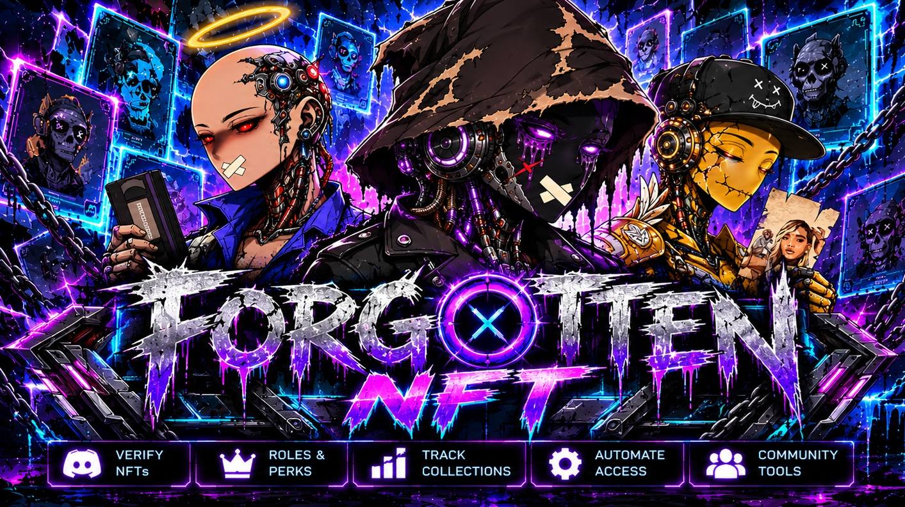

<p align="center">
  
</p>

# FORGOTTEN NFT Engine

A universal **Solana NFT verification and collection engine** for Discord, built
on Discord.Net. FORGOTTEN lets Discord members inspect Solana NFTs, cryptographically
prove wallet ownership, browse their collections, and expose verified ownership to
external games — without hardcoding any single NFT collection.

> **Status:** Phases 0–5 complete and running in production. NFT inspection/verification,
> the `/nft-admin` registry, **cryptographic wallet verification** (`/wallet`, on desktop
> **and** mobile), an **interactive NFT showcase** with a public **📢 Flex** and a
> **holdings leaderboard** (`/nft showcase`, `/nft leaderboard`), **background ownership
> monitoring with NFT-gated Discord roles**, and a **verify-log announcer** all work.
> Phase 6 (external game / POW integration) is the last — see the [Roadmap](#roadmap).

The engine is **collection-agnostic**: it validates and displays NFTs from any
compatible Solana collection, while game-specific logic (e.g. Dead Mint Carnival /
POW fighting) consumes it through clean integration interfaces.

---

## Tech stack

| Concern | Technology | Version |
|---|---|---|
| Runtime | .NET | 10.0 LTS |
| Discord | Discord.Net | 3.20.2 |
| Persistence | EF Core + SQLite | 10.0.13 |
| Blockchain | Solana via DAS-compatible RPC (Metaplex DAS) | — |
| Auth | Solana Ed25519 signatures | — |
| HTTP resilience | Microsoft.Extensions.Http.Resilience | 10.11.0 |
| Host / DI / Options / Logging | Microsoft.Extensions.* | 10.0.x |
| Tests | xUnit | 2.9.3 |

## Solution layout

```
Forgotten.slnx
├── src/
│   ├── Forgotten.Bot                 # Discord presentation + Generic Host (composition root)
│   ├── Forgotten.Nft.Domain          # Entities, enums, value objects, events (no external deps)
│   ├── Forgotten.Nft.Application      # Services, interfaces, DTOs, options + validation
│   ├── Forgotten.Nft.Infrastructure   # EF Core/SQLite, blockchain, metadata, caching, workers
│   ├── Forgotten.Nft.WalletWeb        # HTTPS wallet-verification site (Phase 3)
│   └── Forgotten.Nft.Integrations     # Discord roles, POW adapter (Phases 5–6)
└── tests/
    ├── Forgotten.Nft.UnitTests
    ├── Forgotten.Nft.IntegrationTests
    └── Forgotten.Nft.SecurityTests
```

Dependency direction is enforced (`Domain ← Application ← Infrastructure`, with
`Bot` as the only composition root). A unit test asserts the Domain layer never
references Discord.Net or EF Core. See [docs/ARCHITECTURE.md](docs/ARCHITECTURE.md).

## Getting started

### Prerequisites

- [.NET 10 SDK](https://dotnet.microsoft.com/download) (10.0.100+)
- A Discord bot application + token ([Discord Developer Portal](https://discord.com/developers/applications))
- A DAS-compatible Solana RPC endpoint (Metaplex DAS — e.g. Helius) for NFT inspection/verification. Must support the `getAsset` method; plain RPCs without DAS won't work.
- **For wallet verification:** a reachable origin for the `Forgotten.Nft.WalletWeb` site — `localhost` works for a single-machine test; a public **HTTPS** URL is required for other members to verify. Members sign with a Solana wallet (e.g. Phantom).

### Build & test

```bash
git clone https://github.com/BMFer/Forgotten.git
cd Forgotten
dotnet build Forgotten.slnx
dotnet test Forgotten.slnx
```

### Configure secrets

Secrets never live in committed files. Supply the Discord token (and, later,
provider API keys) via user secrets or environment variables:

```bash
# user secrets (recommended for local dev)
dotnet user-secrets set "Discord:Token" "<your-bot-token>" --project src/Forgotten.Bot

# DAS provider endpoint (often embeds an API key — keep it out of appsettings)
dotnet user-secrets set "Solana:DasEndpoint" "https://<das-provider>/?api-key=..." --project src/Forgotten.Bot

# optional: fast, guild-scoped slash-command registration during development
dotnet user-secrets set "Discord:DevGuildId" "<your-guild-id>" --project src/Forgotten.Bot
```

Environment variables use the `Section__Key` form, e.g. `Discord__Token`.
Copy non-secret settings from [`appsettings.Example.json`](src/Forgotten.Bot/appsettings.Example.json).

### Run the bot

```bash
dotnet run --project src/Forgotten.Bot
# expect a startup banner, then: "FORGOTTEN ready as <bot>"
```

The host **fails closed**: if the Discord token (or any security-critical setting)
is missing or invalid, startup is refused with a clear validation error rather than
continuing in a degraded state. Pending database migrations are applied
automatically on startup (additively — never dropping data).

## Discord commands

Member commands:

| Command | Description |
|---|---|
| `/nft inspect <address>` | Inspect an NFT: artwork, owner, traits, status |
| `/nft verify <address>` | Layered verification — validity · on-chain collection · registry approval |
| `/nft showcase [collection]` | Flex your NFTs — defaults to this server's collection; switch with the dropdown (or "All my NFTs"). Paginated, interactive, with a **📢 Flex** button to post an NFT publicly (with traits, your avatar, and a ✅ Verified holder badge). Optionally gated to a holders-only role (`Discord:FlexRoleId`) |
| `/nft leaderboard` | Top 10 verified holders of this server's collection (cached ~10 min) |
| `/nft collection <address>` | Show a collection and a page of its NFTs |
| `/nft attributes <address>` | Show just the NFT's traits |
| `/nft refresh <address>` | Re-fetch an NFT, bypassing the cache |
| `/nft help` | Step-by-step guide: verify your wallet and flex your NFTs |

Wallet commands (all responses ephemeral):

| Command | Description |
|---|---|
| `/wallet connect` | Get a one-time link to cryptographically verify a wallet (Ed25519 sign-in) |
| `/wallet verify` | Check whether you have a verified wallet |
| `/wallet list` | List your connected wallets |
| `/wallet status` | Show verification status + primary wallet |
| `/wallet primary <address>` | Set your primary wallet |
| `/wallet disconnect <address>` | Disconnect a wallet |

Administrator commands (guild administrators only; responses are ephemeral):

| Command | Description |
|---|---|
| `/nft-admin collection-add <address> [name]` | Approve a collection for this server (the first becomes the showcase default) |
| `/nft-admin collection-default <address>` | Set which approved collection `/nft showcase` shows by default |
| `/nft-admin collection-remove <address>` | Remove a collection's approval |
| `/nft-admin collection-list` | List approved collections (⭐ marks the default) |
| `/nft-admin role-map <collection> <role>` | Grant a role to holders of an approved collection |
| `/nft-admin role-unmap <collection>` | Stop granting a role for a collection |
| `/nft-admin role-list` | List collection→role mappings |
| `/nft-admin role-sync` | Reconcile NFT-gated roles against current ownership now |
| `/nft-admin provider-status` | Show Solana provider configuration status |
| `/nft-admin cache-clear` | Clear cached inspection data |
| `/nft-admin verification-log` | Recent verification activity |

> Verification keeps three facts strictly separate: **on-chain collection
> verification ≠ registry approval ≠ ownership**.

## Wallet verification

Wallet ownership is proven cryptographically — never by submitting an address
(spec §7.1). `/wallet connect` issues a short-lived, single-use link to the
`Forgotten.Nft.WalletWeb` site; the member connects a Solana wallet and signs a
server-built message bound to their Discord account, the wallet, a nonce, and the
domain. The signature is verified server-side with Ed25519.

The web app shares the bot's SQLite database and must run at the origin configured
in `WalletVerification:PublicBaseUrl` (HTTPS in production; `localhost` for a local test):

```bash
# serve the signing site (point it at the same DB the bot uses)
dotnet run --project src/Forgotten.Nft.WalletWeb
```

Keys and seed phrases are never requested, transmitted, or stored.

**On mobile**, where browsers have no wallet extension, the page detects the device and
offers **Open in Phantom / Open in Solflare** deep-links that reopen it inside the wallet
app's in-app browser, where connecting and signing work. Inside a wallet browser it shows a
single **Connect wallet** button, then a dedicated **✍️ Sign to verify** step so the approval
prompt fires reliably.

## Ownership monitoring & roles

A background worker (enabled by `NftEngine:EnableOwnershipMonitoring`, every
`OwnershipPollingMinutes`) re-checks ownership of tracked NFTs in approved
collections. Observed owner changes are recorded to history — **without fabricating
a transfer transaction** (spec §10.2) — raised as domain events, and the inspect
cache is invalidated.

Admins map an approved collection to a role with `/nft-admin role-map`; the worker
(and `/nft-admin role-sync`) then grants the role to members who hold a qualifying
NFT and removes it from those who no longer do. Safeguards (spec §11): a provider
outage **never** strips roles; privileged roles (Administrator / Manage Roles /
Manage Guild) and roles above the bot are refused.

> For live role changes the bot needs the **Manage Roles** permission and its role
> positioned **above** the managed role in the server's role list.

When `Discord:VerifyLogChannelId` is set, each successful wallet verification is announced to
that channel as an embed — the member (with their avatar), their short wallet address, and how
many of the server's default collection they hold. A member who verifies a wallet holding the
mapped collection is granted the mapped role (e.g. a **Wallet Verified** role) by the ownership
sync, which can also gate `/nft showcase` via `Discord:FlexRoleId`.

## Configuration overview

| Section | Purpose | Notes |
|---|---|---|
| `Discord` | Bot token, optional dev guild id, holders-flex role (`FlexRoleId`), verify-log channel (`VerifyLogChannelId`) | Token is a **secret** |
| `Database` | SQLite connection string, busy timeout | WAL + foreign keys enforced |
| `Solana` | Network, DAS/RPC endpoints, timeouts, paging, cache TTL | DAS endpoint/API keys via secrets |
| `Metadata` | IPFS/Arweave gateways, size/time/redirect limits | SSRF-guarded fetches |
| `Presentation` | Explorer base URL, placeholder image, command cooldown | — |
| `WalletVerification` | Public base URL, domain, session TTL, max wallets, duplicate-claim policy | Must be HTTPS (localhost exempt); fails closed |
| `NftEngine` | Feature flags (monitoring, showcase, POW, limits) | Validated at startup |

All options are strongly typed and validated on startup (DataAnnotations +
cross-field validators). Full details land in `docs/CONFIGURATION.md` as phases
complete.

## Database

SQLite via EF Core, evolved **only** through migrations — the database is never
auto-dropped or recreated. Pending migrations are applied automatically when the
bot starts (additive `Database.Migrate()`), so the schema stays in sync with the
code with no manual step. Tables so far: `NftAssets`, `NftAttributes` (Phase 1),
`NftCollections`, `NftVerificationLogs` (Phase 2), `WalletVerificationChallenges`,
`DiscordWalletConnections` (Phase 3), `NftGallerySessions` (Phase 4),
`NftOwnershipHistory`, `GuildRoleMappings` (Phase 5).

To add or inspect migrations during development:

```bash
dotnet ef migrations add <Name> \
  --project src/Forgotten.Nft.Infrastructure \
  --startup-project src/Forgotten.Nft.Infrastructure
```

## Roadmap

Each phase is a self-contained, tested vertical slice. Full guides live in
[`docs/phases/`](docs/phases/README.md).

| Phase | Deliverable | Status |
|------|-------------|--------|
| **0 — Bootstrap** | Solution, host, DI, config, Discord + SQLite foundation | ✅ Complete |
| **1 — Foundation** | `/nft inspect` against a DAS provider | ✅ Complete |
| **2 — Verification** | `/nft verify` + collection approval registry | ✅ Complete |
| **3 — Wallet** | Cryptographic Ed25519 wallet ownership proof | ✅ Complete |
| **4 — Showcase** | Interactive, paginated `/nft showcase` | ✅ Complete |
| **5 — Monitoring** | Background ownership tracking + role sync | ✅ Complete |
| **6 — Game integration** | Ownership/eligibility interfaces for POW | ⬜ Next |

## Security principles

- Wallet ownership is **proven cryptographically** (Ed25519) — never by submitting an address.
- Private keys / seed phrases are never requested or stored.
- NFT metadata is untrusted input: sanitized, size/time-bounded, SSRF-protected.
- Blockchain providers are external dependencies; a failed request **never** grants access.
- Security-critical configuration **fails closed** at startup.
- The verification site is HTTPS-only with **HSTS**, a strict **Content-Security-Policy**, and clickjacking/MIME-sniffing protections.
- Admin commands are gated server-side (**Administrator-only, guild-only, fail-closed**) and verified by a test.

See the spec's full security requirements and (as phases land) `docs/SECURITY.md`.

## Documentation

- [Technical specification](docs/specs.md) — the complete requirement set.
- [Architecture](docs/ARCHITECTURE.md) — layering, host, persistence baseline.
- [Phase guides](docs/phases/README.md) — the phased build plan.

## License

[MIT](LICENSE) © 2026 Jerrame Hertz
